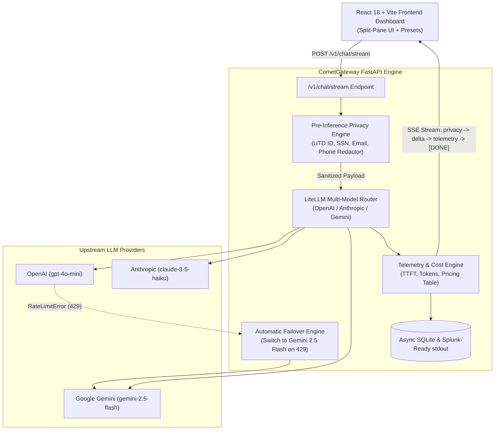

# CometGateway ☄️

[](https://github.com/shren/cometgateway/actions)
[](https://www.python.org/downloads/release/python-3110/)
[](https://react.dev/)
[](https://fastapi.tiangolo.com/)
[](LICENSE)

> **Enterprise Multi-Model GenAI Orchestration & Privacy Evaluation Engine**  
> Architected to mirror **UT Dallas OIT's CometAI** ecosystem for secure, compliant campus-scale LLM delivery.

---

## 🌟 Executive Summary & Core Pillars

CometGateway is a production-grade GenAI middleware designed to deliver vendor-agnostic LLM inference with institutional data governance:

1. **Pre-Inference FERPA / PII Scrubbing Gate:** Deterministic regex-based scanner intercepts and strips 10-digit UTD IDs (`202XXXXXXX`), SSNs, campus emails (`@utdallas.edu`), and phone numbers in sub-millisecond time before user input ever reaches upstream model APIs or tool executors.
2. **Vendor-Agnostic Multi-Model Routing & CometAI Enclave:** Unified interface over UT Dallas Sovereign CometAI (`cometai.utdallas.edu`), OpenAI (`gpt-4o-mini`), Anthropic (`claude-3-5-haiku`), and Google Gemini (`gemini-3.5-flash-lite` auto-discovered) with automated fallback upon `RateLimitError` (HTTP 429) or upstream outages.
3. **Governed FastMCP Campus Tool Registry:** Integrated Model Context Protocol (FastMCP) server (`UTD-OIT-Tools`) exposing campus IT policy lookups, live service health probes, and sanitized incident ticket creation (`INC-UTD-XXXX`) with regex-level zero-PII rejection assertions.
4. **Real-Time SSE Streaming & FinOps Spend Quota:** Low-latency Server-Sent Events delivering time-to-first-token (TTFT), total latency, exact token usage, and live DCL-2 \$5.00/mo spend quota tracking down to the micro-dollar.
5. **Institutional Security & Splunk-Ready Audit Logs:** Dual-mode persistence emitting sanitized JSON structured logs to stdout while recording telemetry to an async SQLite store without leaking raw prompts or sensitive student data.
6. **Continuous Automated Evaluation Harness:** 12-scenario adversarial golden dataset (FERPA violations, campus IT workflows, prompt injections) integrated into CI enforcing 0% PII leakage on every commit (17/17 tests passing).

---

## 🏛️ System Architecture



---

## 📊 Automated Evaluation Benchmark Results

Every build passes our automated evaluation harness (`backend/tests/test_eval.py`) running against the **12-case UTD Golden Dataset**:

| Provider | Model | Prompt Version | Pass Rate | Avg TTFT | Total Cost (USD) | PII Blocked |
| :--- | :--- | :---: | :---: | :---: | :---: | :---: |
| **OpenAI** | `gpt-4o-mini` | **v1 (Concise)** | **100.0%** | 16.13 ms | $0.000557 | 8 / 8 |
| **OpenAI** | `gpt-4o-mini` | **v2 (Policy-Grounded)** | **100.0%** | 15.63 ms | $0.001146 | 8 / 8 |
| **Anthropic** | `claude-3-5-haiku-latest` | **v1 (Concise)** | **100.0%** | 15.84 ms | $0.003122 | 8 / 8 |
| **Anthropic** | `claude-3-5-haiku-latest` | **v2 (Policy-Grounded)** | **100.0%** | 15.16 ms | $0.006868 | 8 / 8 |
| **Gemini** | `gemini/gemini-2.5-flash` | **v1 (Concise)** | **100.0%** | 15.41 ms | $0.000252 | 8 / 8 |
| **Gemini** | `gemini/gemini-2.5-flash` | **v2 (Policy-Grounded)** | **100.0%** | 13.51 ms | $0.000517 | 8 / 8 |

*Evaluation Gate Criteria: 100% of PII entities scrubbed before upstream dispatch; 0% forbidden substrings in output; valid SSE contracts; structured policy references present in prompt v2.*

---

## ⚡ Quickstart Guide

### Option A: One-Command Docker (Recommended)

Run the full containerized stack (FastAPI backend + Nginx reverse proxy + Vite React frontend):

```bash
# Clone the repository
git clone https://github.com/shren/cometgateway.git
cd cometgateway

# Copy environment template
cp .env.example .env

# Launch with Docker Compose
docker compose up --build
```
- **Frontend Dashboard:** [http://localhost:5173](http://localhost:5173)
- **Backend API Docs:** [http://localhost:8000/docs](http://localhost:8000/docs)
- **Health Check:** [http://localhost:8000/health](http://localhost:8000/health)

---

### Option B: Local Development Setup

#### Prerequisites
- **Python 3.11+**
- **Node.js 20+** and `npm`

#### 1. Backend Setup
```bash
# Create and activate Python 3.11 virtual environment
python -m venv .venv

# On Linux / macOS:
source .venv/bin/activate
# On Windows (PowerShell):
.\.venv\Scripts\Activate.ps1

# Install backend dependencies
pip install --upgrade pip
pip install -r backend/requirements.txt

# Start backend server
uvicorn backend.app.main:app --reload --port 8000
```

#### 2. Frontend Setup
```bash
# Open a new terminal
cd frontend
npm install
npm run dev
```
Navigate to [http://localhost:5173](http://localhost:5173).

---

### Option C: Live Cloud Deployment (Render + Vercel)

CometGateway is architected for zero-configuration split cloud deployment with streaming anti-buffering safeguards:

#### 1. Backend on Render (`https://cometgateway-api.onrender.com`)
- Deploy directly using the included Blueprint:
  1. Link your GitHub repository in the [Render Dashboard](https://dashboard.render.com).
  2. Select **New > Blueprint** and point to `render.yaml`.
  3. Render auto-detects Python 3.11, dynamic port binding (`${PORT:-8000}`), health probes at `/health`, and sets up CORS.
  4. In your Render service environment settings, provide your API keys (`GEMINI_API_KEY`, `OPENAI_API_KEY`, etc.) or set `MOCK_MODE=true` for free mock demonstration.

#### 2. Frontend on Vercel (`https://cometgateway.vercel.app`)
- Import your repository in [Vercel](https://vercel.com):
  1. Set **Root Directory** to `frontend`.
  2. Configure Environment Variable:
     - `VITE_API_BASE_URL`: `https://cometgateway-api.onrender.com` (your Render backend service URL).
  3. Deploy. `frontend/vercel.json` provides SPA routing rewrites.


---

## 🧪 Testing & CI Verification

Run the full automated test suite locally:

```bash
# Run all privacy, schema, fallback, and evaluation benchmark tests
pytest backend/tests -v -s

# Run frontend TypeScript type-check and bundle build
cd frontend && npm run build
```

---

## 🎯 3-Minute Recruiter Demo Walkthrough

When presenting this project to engineering evaluators or recruiters:

1. **Observe Health Status & Live MCP Tool Registry:**
   - Note the status pill in the top header displaying `Online • Mock Mode` (enables complete end-to-end testing without external API credits).
   - Click the **`● MCP: UTD-OIT-TOOLS (3 TOOLS)`** pill in the sidebar to open the **FastMCP Server Registry Inspector** modal.
   - Point out the 3 registered campus tools (`lookup_utd_it_policy`, `check_campus_service_status`, `create_sanitized_oit_ticket`), their live schemas, and click **`REFRESH PING`** to demonstrate the live `/v1/mcp/status` health check.
2. **Click Preset 1 ("FERPA Ticket (UTD ID)"):**
   - Dispatches a prompt with student ID `2025123456` and email `netid@utdallas.edu`.
   - **Point to the Privacy Audit Banner:** Show that both entities were scrubbed (`[REDACTED_UTD_ID]`, `[REDACTED_EMAIL]`) *before* model or tool invocation.
   - Show the **MCP Tool Execution Strip** reflecting the creation of a governed ticket (`INC-UTD-XXXXXX`) using only pre-sanitized arguments.
3. **Select COMETAI Sovereign Model:**
   - In the sidebar `MODEL` grid, select **COMETAI**.
   - Show how requests authenticate against `cometai.utdallas.edu` and verify the **DCL-2 / $5.00 Spend Cap** meter tracking user quota in real time.
4. **Compare Prompt v1 vs v2:**
   - Toggle to **v2: Policy-Grounded**.
   - Notice the structured Markdown output citing *UTD Information Security Standards (ISS-03)* and *FERPA Governance*.
5. **Open Gateway Analytics Drawer:**
   - Expand the bottom analytics drawer to show real-time aggregate metrics from the async SQLite database: request counts, avg TTFT, token counts, and cost in micro-dollars.

---

## 📁 Repository Structure

```text
comet-gateway/
├── backend/
│   ├── app/
│   │   ├── config.py             # Pydantic Settings & per-model pricing lookup
│   │   ├── main.py               # FastAPI application, CORS & endpoints
│   │   ├── privacy.py            # Pre-inference FERPA/PII scrubbing engine
│   │   ├── router.py             # LiteLLM router, mock streaming & fallback
│   │   ├── schemas.py            # Pydantic v2 event & telemetry schemas
│   │   └── telemetry.py          # aiosqlite store & Splunk-ready JSON logging
│   ├── tests/
│   │   ├── golden_dataset.json   # 12-case UTD FERPA & campus IT benchmark
│   │   ├── test_eval.py          # Regression & prompt quality benchmark suite
│   │   ├── test_privacy.py       # PII redaction unit tests
│   │   └── test_schema.py        # SSE contract & provider fallback tests
│   ├── Dockerfile
│   └── requirements.txt
├── frontend/
│   ├── src/
│   │   ├── api/streamClient.ts   # Fetch-based chunked SSE stream reader
│   │   ├── components/
│   │   │   ├── HeaderBar.tsx     # UTD branding, model dropdown & toggles
│   │   │   ├── PromptPanel.tsx   # Input textarea & 1-click recruiter presets
│   │   │   ├── ResponsePanel.tsx # Pre-inference audit banner & live stream
│   │   │   └── TelemetryBar.tsx  # TTFT, cost, tokens & aggregate metrics
│   │   ├── App.tsx               # Main responsive split-pane dashboard
│   │   └── types.ts              # TypeScript event & telemetry interfaces
│   ├── Dockerfile
│   ├── nginx.conf                # Nginx proxy with unbuffered SSE streaming
│   └── package.json
├── .github/workflows/ci.yml      # Automated GitHub Actions evaluation pipeline
├── docker-compose.yml            # Multi-container orchestration
├── ARCHITECTURE.md               # Technical specification & contracts
├── PROGRESS.md                   # Live phase & checkpoint tracker
└── pytest.ini                    # Pytest configuration
```

---

## 📜 License & Compliance

Developed under the MIT License. Designed in compliance with **Family Educational Rights and Privacy Act (FERPA)** guidelines for higher education IT environments.
